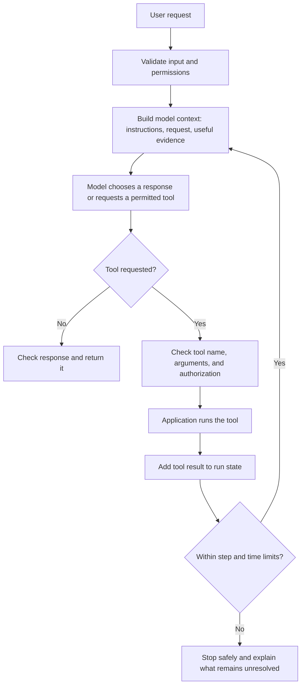

# AI Agents and Workflows: A Beginner's Guide

This guide explains how an AI agent works from request to response, how to read an agent project, and how to learn from the AI repositories in your GitHub account. It assumes no prior agent-framework knowledge.

## 1. The vocabulary

| Term | Plain-language meaning | Example |
| --- | --- | --- |
| **AI model** | A trained program that maps input to output. A language model generates text token by token. | A hosted language model answers a question from the prompt it receives. |
| **AI application** | Ordinary software around a model: user interface, validation, model request, and response handling. | An API endpoint accepts a chat request and calls a model. |
| **Workflow** | A set of steps and routing rules selected by the developer. | Validate input → retrieve documents → draft answer → check citations. |
| **Agent** | An AI application in which the model can choose among permitted actions or tools to pursue a goal. | The model decides whether to search, calculate, or ask a follow-up question. |
| **Tool** | A named function the application can let a model request. The application executes it and returns its result. | Search a local knowledge base or calculate a total. |
| **State** | Information carried through one run. | User request, current step, tool results, and remaining attempt count. |
| **Memory** | Information saved beyond the current model request or session. | A user-approved preference stored for later retrieval. |
| **RAG** | Retrieval-augmented generation: find relevant sources and include them in the model's context before it answers. | Retrieve passages from a handbook and answer with source references. |
| **Evaluation** | A repeatable way to check if outputs meet requirements. | Assert that a tool sequence is correct and latency stays below a limit. |

**Important distinction:** calling a model from an API does not automatically make software an agent. A simple chat endpoint is an AI application. It becomes more agent-like when the model selects actions, the application executes those actions, and a controlled loop uses the results to decide what to do next.

## 2. A basic agent workflow



The model does **not** directly execute code or access every computer system. In a well-designed tool flow, it proposes a structured call, and the application validates and executes only the tools it deliberately provides. The result is fed back to the model as new context. The application should enforce permissions, argument checks, timeouts, and limits itself; do not rely on the model to enforce its own security boundary.

### One run in simple words

1. A user gives a goal and relevant information.
2. The application checks that the request is valid and that the user is allowed to perform the requested action.
3. The application sends the model instructions, the request, and only the context it needs.
4. The model either gives a final answer or asks to use one of the tools it has been offered.
5. The application validates that request, runs the tool, and records the result in the current run's state.
6. The model sees the result and decides whether it has enough information or needs another permitted step.
7. A stop rule ends the run; the application checks and returns the result, with uncertainty or citations where appropriate.

A useful first agent should have a **narrow goal**, a **small tool list**, a **maximum number of steps**, and a way to stop or ask a human. Unlimited loops, broad credentials, and unreviewed consequential actions are not good defaults.

## 3. What goes into the model's context?

A model request commonly includes some combination of:

- **System/developer instructions:** the task, behavior boundaries, and response format.
- **User message:** what the person asked for.
- **Conversation history:** selected earlier messages, subject to a context-size limit.
- **Retrieved evidence:** relevant passages, records, or search results.
- **Tool descriptions:** what actions are available and the arguments they accept.
- **Tool results:** outputs from actions already taken in this run.

The model has a finite **context window**. Sending more history is not the same thing as durable memory: older details may be omitted, summarized, or exceed the available window. Applications need an explicit policy for what they retain, retrieve, show to the model, and delete.

A **token** is a piece of text processed by a language model; it may be a word, part of a word, punctuation, or other symbol. Token counts influence context size, latency, and cost for paid model APIs.

## 4. Tools, function calling, and permissions

A tool is regular application code with a defined interface. For example, a weather tool could accept a city and return a forecast. A calculator can be more reliable than asking a model to do arithmetic mentally.

The tool-call cycle is:

```text
model proposes tool + arguments
        ↓
application validates schema, permission, and limits
        ↓
application runs the function
        ↓
tool result is added to the current run
        ↓
model continues or returns a final answer
```

Good tool design means:

- Give tools narrow, descriptive names and typed, validated arguments.
- Give each tool only the permissions it needs; avoid arbitrary shell, filesystem, or network access unless essential and tightly constrained.
- Treat tool output and retrieved web content as **untrusted input**. It can contain misleading instructions (prompt injection); it must not override application policy.
- Add timeouts, rate limits, retries where safe, and clear error responses.
- Require explicit human confirmation before actions that are costly, public, irreversible, or affect a person's rights or money.
- Keep an audit trail that avoids storing secrets and unnecessary personal data.

## 5. Memory and RAG are not the same thing

### Memory

Memory is application-managed information retained across requests. It can be a profile setting, a saved note, a database record, or a searchable collection. Decide what can be stored, who can see it, how long it remains, how a user corrects it, and how it can be deleted. A vector database is one possible storage/retrieval component—not a complete memory policy.

### RAG (retrieval-augmented generation)

A typical document RAG workflow is:

1. Split source documents into manageable passages (**chunking**).
2. Convert passages to vectors (**embeddings**) that represent aspects of their meaning.
3. Store vectors with source metadata in an index.
4. Convert a question to a vector and retrieve relevant passages.
5. Send the question and selected passages to the model.
6. Return an answer grounded in the evidence and, where useful, cite the source.

RAG does not train the model or guarantee that retrieved evidence is correct. Test whether the right sources are retrieved, whether answers are supported by them, and what happens when no relevant source is found. Preserve source identifiers so a reviewer can trace an answer.

## 6. Fixed workflow or agent?

| Prefer a fixed workflow when… | Consider agent decisions when… |
| --- | --- |
| The steps are known and should happen consistently. | The next step genuinely depends on what the system discovers. |
| The task is high risk, regulated, or must be easy to audit. | There are several safe, bounded actions and the model can select among them usefully. |
| You want predictable latency and cost. | Flexibility demonstrably improves the task enough to justify extra cost and variability. |

A practical pattern is **workflow first, agent only where needed**. Keep input validation, authorization, irreversible actions, and final checks in ordinary deterministic code. The model can help interpret, rank, summarize, or choose among safe options without owning the system's security decisions.

## 7. Single-agent and multi-agent systems

A single agent may use several tools. A multi-agent system gives different model-driven roles separate responsibilities (for example: planner, researcher, writer, and reviewer) and defines how their outputs are coordinated.

More agents do not automatically mean better results. Each handoff can add latency, cost, inconsistent assumptions, and new failure modes. If you use multiple roles:

- State each role's responsibility and input/output format.
- Share a controlled state rather than relying on vague chat history.
- Decide which tasks can run in parallel and which require an ordered handoff.
- Define who can finish, who can ask for revision, and how to prevent endless review loops.
- Evaluate the complete workflow, not just the individual agent responses.

A graph orchestrator represents steps as **nodes** and allowed transitions as **edges**. Conditional edges choose the next node based on state. That makes routing and stop conditions easier to inspect than a free-form loop.

## 8. Safety, privacy, and reliability checklist

Before using an agent with real users, ask:

- **Scope:** What is it intended to do, and explicitly not do?
- **Authorization:** Which user may invoke each tool? Is access checked in server-side code?
- **Human oversight:** Which actions require confirmation or expert review?
- **Data:** Is private information sent to a third-party model? Is it retained? Can a user delete it?
- **Prompt injection:** Can hostile text in documents, webpages, or tool results trick the model into requesting actions?
- **Output quality:** Can the system signal uncertainty, cite evidence, and fall back when evidence is missing?
- **Limits:** Are there caps for tool calls, time, retries, token use, and cost?
- **Failures:** What happens on invalid output, provider outage, timeout, rate limit, or partial completion?
- **Testing:** Do tests cover normal cases, edge cases, prohibited actions, and failure paths?
- **Monitoring:** Can you measure quality and cost without logging sensitive content unnecessarily?

Passing a handful of tests does not prove a system safe or correct. Use representative test cases and human review proportional to the consequences of failure.

## 9. Learn from the AI projects in your GitHub account

These are your repositories, not external endorsements. The notes below are based on their current READMEs and a sample of source files. Some READMEs describe planned or intended architecture; compare each claim with the actual entry point and implementation before treating it as finished functionality.

### Recommended order

1. **[partner-ai-agent](https://github.com/Aayush1003/partner-ai-agent)** — start with the smallest model-backed API. Read [`app/main.py`](https://github.com/Aayush1003/partner-ai-agent/blob/main/app/main.py) and [`app/config.py`](https://github.com/Aayush1003/partner-ai-agent/blob/main/app/config.py). Follow `POST /api/chat`: validate request → optionally call the OpenAI-compatible API → return a response. This is a useful way to see the boundary between an API application and an agent; it is a starter chat service, not a tool-using autonomous loop.

2. **[ai-stock-market-agent](https://github.com/Aayush1003/ai-stock-market-agent)** — learn modular, bounded task orchestration. Read [`src/stock_agent/runner.py`](https://github.com/Aayush1003/ai-stock-market-agent/blob/main/src/stock_agent/runner.py), then `providers.py`, `research.py`, and `models.py`. A research request gets market data and news, then builds a structured report. The README says the optional LLM explains supplied factors; it cannot change the recommendation or trade. Treat it as research software, not investment advice.

3. **[income-tax-ai-agent](https://github.com/Aayush1003/income-tax-ai-agent)** — study deterministic validation and consent boundaries. Read [`services/pan_service.py`](https://github.com/Aayush1003/income-tax-ai-agent/blob/main/services/pan_service.py), then `app.py` and its tests. The service validates a PAN-like format and maps allowlisted fields from included demo records. The README explicitly says to replace demo data with an authorized verified source in production; do not treat it as a real government lookup.

4. **[youtube-ai-agent](https://github.com/Aayush1003/youtube-ai-agent)** — study a larger human-reviewed product workflow. Start with [`docs/agentic-product-operating-model.md`](https://github.com/Aayush1003/youtube-ai-agent/blob/main/docs/agentic-product-operating-model.md), then its README, `server.js`, `app.js`, and `src/` workflow modules. The documented loop is discover → decide → build → verify → learn, with a human owning decisions. The README distinguishes built-in starter planning from optional Gemini generation and says scheduled drafts are not automatically rendered or published.

5. **[reliable-ai-agents](https://github.com/Aayush1003/reliable-ai-agents)** — learn how to test agent behavior without making live model calls. Read [`agent_eval/evaluator.py`](https://github.com/Aayush1003/reliable-ai-agents/blob/main/agent_eval/evaluator.py), `agent_eval/cases.py`, `examples/sample_runs.jsonl`, and `tests/test_evaluator.py`. It checks recorded runs for response text, tool sequence, latency, and cost, and reports failures. Evaluation helps find regressions; it is not a safety certification.

6. **[mindforge-agentic-os](https://github.com/Aayush1003/mindforge-agentic-os)** — explore memory and mission-planning concepts. Read [`mindforge/engine.py`](https://github.com/Aayush1003/mindforge-agentic-os/blob/main/mindforge/engine.py), then `memory.py`, `mission.py`, `cli.py`, and tests. The README describes a memory-first agentic prototype; the inspected engine uses local memory and deterministic response/planning helpers. Verify model/API integration in the code rather than assuming every response is generated by an LLM.

7. **[ai-agent-arena](https://github.com/Aayush1003/ai-agent-arena)** — explore the idea of graph-based multi-agent orchestration. Read [`workflows/game_loop.py`](https://github.com/Aayush1003/ai-agent-arena/blob/main/workflows/game_loop.py), `agents/base_agent.py`, `main.py`, and tests. The README describes a larger LangGraph/MCP/RAG architecture, but the inspected game loop currently has simulated nodes (print statements and delays), while `BaseAgent.act` is a placeholder. Use it to learn the intended graph shape, and distinguish that prototype from implemented integrations.

### A good code-reading method

For each project, answer these questions in order:

1. Where does execution start? (CLI, web server, or script.)
2. What input enters, and where is it validated?
3. Which module makes a model call, if any?
4. What is deterministic application code versus model-generated output?
5. What can the model request, and where is that request checked and executed?
6. What state, memory, external data, or retrieved documents are used?
7. How does the run stop? What errors can occur?
8. Which tests show intended behavior, and which claims in the README are not yet demonstrated by code?

## 10. A beginner project ladder

Build these in order, and keep each small:

1. **Prompt-to-JSON:** ask a model to classify a request into a validated schema; reject invalid responses.
2. **One safe tool:** add a read-only calculator or local FAQ search; validate arguments and return tool results.
3. **Grounded FAQ (RAG):** use a small set of non-sensitive documents; cite retrieved passages and test when evidence is missing.
4. **Bounded workflow:** add explicit steps, a maximum tool-call count, error handling, and a stop rule.
5. **Evaluation set:** save representative inputs and expected checks; run them after prompt, model, or code changes.
6. **Human-reviewed action:** only after the previous steps work, draft an action for approval rather than performing consequential actions automatically.

For every project, write down the user, goal, non-goals, sample inputs, expected outputs, tests, limitations, and data/privacy choices. The [AI Engineering checklist](../engineering/README.md) has a practical release checklist.

## 11. Quick glossary

- **Prompt:** instructions and input sent to a model.
- **Inference:** using a trained model to produce an output.
- **Structured output:** output constrained to a shape such as JSON; still validate it.
- **Embedding:** a numeric representation used to compare semantic similarity.
- **Vector store:** a system that stores/searches vectors and metadata; not automatically a trustworthy knowledge source.
- **Hallucination:** plausible-sounding generated content that is unsupported or incorrect.
- **Guardrail:** a technical or human control limiting unsafe or out-of-scope behavior.
- **Human-in-the-loop:** a person reviews, approves, or corrects a meaningful step.
- **Trace:** a record of steps, tool calls, timings, and outcomes for debugging/evaluation.
- **MCP:** Model Context Protocol, a standard for exposing tools/context to AI applications; it does not itself make an application safe.

## Further reading

- [AI foundations in this repository](../fundamentals/README.md)
- [Transformer guide in this repository](../transformers/README.md)
- [AI engineering checklist in this repository](../engineering/README.md)
- [Hugging Face course](https://huggingface.co/learn)
- [OWASP Top 10 for LLM Applications](https://owasp.org/www-project-top-10-for-large-language-model-applications/)
- [NIST AI Risk Management Framework](https://www.nist.gov/itl/ai-risk-management-framework)
